### Protection and control engineer

Power system protection studies, Siemens PLC automation and machine vision for quality control, from four years of coursework and an 18-week R&D internship. B.Eng (Hons) Electrical and Electronic Engineering, APU, 2026. UAE Golden Visa, so no sponsorship is needed. Available to start now.

**R&D Project Engineer (Internship)**, Control Easy Technology, Malaysia · March to July 2025

- Delivered five quality-control applications, each on a PC and live on a Raspberry Pi 5.
- Trained on Siemens S7-300, S7-200 and S7-1200 PLCs, programming in SCL through TIA Portal.
- Wrote the company's 259-page Open-Source AI Deep Learning technical manual.

 

### Selected work

<table>
<tr>
<td width="33%" valign="top">

 <a href="https://bader915.github.io/portfolio/work/pcb-defect-vit.html"><b>Self-supervised Vision Transformer for PCB defect detection</b></a>
 Vision and AI · Final year project, APU
</td>
<td width="33%" valign="top">

 <a href="https://bader915.github.io/portfolio/work/microgrid-protection.html"><b>Phase and earth-fault protection of an 11 kV network</b></a>
 Power and protection · Switchgear and Protection open-ended lab, APU
</td>
<td width="33%" valign="top">

 <a href="https://bader915.github.io/portfolio/work/golf-ball-qc.html"><b>Automated golf ball inspection station</b></a>
 Automation and PLC · Internship, Control Easy
</td>
</tr>
<tr>
<td width="33%" valign="top">

 <a href="https://bader915.github.io/portfolio/work/wood-defect-segmentation.html"><b>Wood defect segmentation</b></a>
 Vision and AI · Internship, Control Easy
</td>
<td width="33%" valign="top">

 <a href="https://bader915.github.io/portfolio/work/relay-coordination.html"><b>Overcurrent relay coordination study</b></a>
 Power and protection · Switchgear and Protection module, APU
</td>
<td width="33%" valign="top">

 <a href="https://bader915.github.io/portfolio/work/fabric-qc.html"><b>Fabric quality control</b></a>
 Vision and AI · Internship, Control Easy
</td>
</tr>
</table>

### Every project

Open a discipline to see its projects. Each one links to its page on the portfolio, written from its report.

<b>Power and protection</b> · 7 projects

 

- [Overcurrent relay coordination study](https://bader915.github.io/portfolio/work/relay-coordination.html): Settings and time grading for ten IDMT relays on a 230 kV generation and transmission system, with a MATLAB application for the curves.
- [Phase and earth-fault protection of an 11 kV network](https://bader915.github.io/portfolio/work/microgrid-protection.html): Simulink model of a 33/11 kV radial microgrid with phase and earth-fault relays tested under four fault types and six inverse curves.
- [Power flow analysis of a 10-bus network](https://bader915.github.io/portfolio/work/power-flow-10-bus.html): Newton-Raphson, Gauss-Seidel and Fast-Decoupled solutions in MATLAB and PowerWorld, with a 35 MW load increase.
- [Modular smart power hub](https://bader915.github.io/portfolio/work/honeycomb-power-hub.html): A modular, honeycomb-shaped power hub designed in SolidWorks, so one broken socket does not scrap the whole strip.
- [Transformer and alternator testing](https://bader915.github.io/portfolio/work/transformer-alternator.html): Ratio, open-circuit, short-circuit and load tests on a single-phase transformer and a three-phase alternator.
- [Microgrid with solar PV and battery storage](https://bader915.github.io/portfolio/work/microgrid-technology.html): Simulink microgrid with PV, battery state-of-charge control and household and commercial loads, plus power-factor correction.
- [Off-grid wind and battery power conversion](https://bader915.github.io/portfolio/work/wind-energy-system.html): Rectifier, DC-DC converter, battery and three-phase inverter sized and simulated for an off-grid wind turbine.

<b>Automation and PLC</b> · 4 projects

 

- [Automated golf ball inspection station](https://bader915.github.io/portfolio/work/golf-ball-qc.html): A 24 V proximity sensor triggers a camera on a Raspberry Pi 5 through a relay, and a Vision Transformer sorts the balls.
- [Automated bus door control](https://bader915.github.io/portfolio/work/bus-door-control.html): PLC and pneumatic control sequence for safe automatic opening and closing of a bus door.
- [Automotive part control system](https://bader915.github.io/portfolio/work/automotive-part-control.html): C program for handling and checking automotive parts.
- [Coffee making process control](https://bader915.github.io/portfolio/work/coffee-process.html): LabVIEW model that sequences, monitors and controls the steps of coffee preparation.

<b>Vision and AI</b> · 8 projects

 

- [Self-supervised Vision Transformer for PCB defect detection](https://bader915.github.io/portfolio/work/pcb-defect-vit.html): Automated PCB inspection with a self-supervised Vision Transformer and a detector, optimised for GPU inference.
- [Vision system for a hospital logistics AGV](https://bader915.github.io/portfolio/work/hospital-agv-vision.html): Object detection on an NVIDIA Jetson for an automated guided vehicle that moves food and materials in hospitals.
- [PCB component inspection application](https://bader915.github.io/portfolio/work/pcb-component-inspection.html): YOLOv8 inspection that reports each component as Good, Partial or Fail, with checks that catch missing parts and empty sockets.
- [Fabric quality control](https://bader915.github.io/portfolio/work/fabric-qc.html): Classification and defect detection for fabric, retrained on a larger dataset and quantised for the Raspberry Pi 5.
- [Wood defect segmentation](https://bader915.github.io/portfolio/work/wood-defect-segmentation.html): Pixel-level YOLOv11 segmentation of holes and scratches on wooden boards, with a quality score.
- [Medication scanner and obstacle detection](https://bader915.github.io/portfolio/work/medication-scanner.html): Python application on a Jetson for medication image scanning and obstacle detection.
- [Hand gesture recognition](https://bader915.github.io/portfolio/work/hand-gesture.html): Python and OpenCV system recognising hand gestures from a live camera.
- [Baby carrot freshness inspection](https://bader915.github.io/portfolio/work/fruit-inspection.html): Baby carrots graded fresh, aging or spoiled two ways: an OpenCV pipeline reading texture, dark spots, mould and colour, and a Roboflow object-detection model trained on 281 annotated frames, both run from one Tkinter app.

<b>Embedded hardware</b> · 2 projects

 

- [Residential smart parking system](https://bader915.github.io/portfolio/work/parking-system.html): Arduino entry and exit control, parking-space detection and a status display, tested module by module.
- [Temperature control for a batch reactor](https://bader915.github.io/portfolio/work/temperature-control.html): Proposed closed-loop temperature control for a steam-jacketed batch reactor, alongside a separate simulated Arduino monitoring and alarm demonstration in Tinkercad. The demonstration alarms above 37.5 °C; it does not establish control of a physical reactor or steam valve.

<b>Signals and electronics</b> · 7 projects

 

- [Speech enhancement filter](https://bader915.github.io/portfolio/work/sound-purifier.html): MATLAB signal-processing model that removes unwanted components from recorded speech.
- [BJT audio amplifier](https://bader915.github.io/portfolio/work/bjt-amplifier.html): Simulated and analysed a BJT amplifier for audio signals.
- [Discrete-time system with the Z-transform](https://bader915.github.io/portfolio/work/z-transform.html): Step, impulse and frequency response of a discrete-time system computed in MATLAB.
- [FM modulation and demodulation](https://bader915.github.io/portfolio/work/fm-modulation.html): LabVIEW model for FM signal generation, modulation and demodulation.
- [Wheatstone bridge with a potentiometer](https://bader915.github.io/portfolio/work/wheatstone-bridge.html): Balanced and unbalanced Wheatstone bridge simulated in Multisim: the unknown arm found from the bridge ratio, and the output traced from −1.6667 V to 378.79 mV as one arm changed from 1 kΩ to 10 kΩ.
- [Inverting and non-inverting 741 amplifiers](https://bader915.github.io/portfolio/work/op-amp-amplifiers.html): 741 op-amp amplifiers simulated in Multisim with three resistor pairs each: inverting gains of −1, −1.3333 and −0.8571 and non-inverting gains of 2, 2.3333 and 1.8571, all matching the calculated values.
- [Two-port network parameters](https://bader915.github.io/portfolio/work/two-port-network.html): Z- and Y-parameters of resistive T and π networks found from simulated open- and short-circuit tests in LTspice at 5, 10 and 15 V, showing the network is reciprocal.

<b>Software and design</b> · 4 projects

 

- [Vaccination centre system](https://bader915.github.io/portfolio/work/vaccination-centre.html): Python program that organises vaccination-centre records and the service flow.
- [Vaccine inventory system](https://bader915.github.io/portfolio/work/vaccination-inventory.html): C++ program that tracks vaccine stock, records and updates.
- [Two-level library lighting design](https://bader915.github.io/portfolio/work/library-lighting.html): Lighting scheme for a client's two-storey library refurbishment in DIALux evo 11, simulated with and without daylight and checked room by room for lighting power density.
- [Go-kart design](https://bader915.github.io/portfolio/work/go-kart.html): Go-kart assembly and mechanical parts modelled in SolidWorks.

### What I work with

| Area | Tools and methods |
|---|---|
| **Protection** | Phase and earth-fault overcurrent (ANSI 50/51, 50N/51N), IDMT setting and coordination, CT ratio selection, Time–current curves, IEC 60255-151, IEEE C37.112 |
| **Power systems** | Load flow (Newton-Raphson, Gauss-Seidel, Fast-Decoupled), Transformer and alternator tests, Microgrids with PV and storage, Power electronic converters |
| **Automation** | Siemens S7-300, S7-200, S7-1200, TIA Portal and SCL, Relay logic and isolation, Pneumatics, LabVIEW |
| **Vision and AI** | Classification, detection, segmentation, Vision Transformers, YOLOv8, DINOv2, TensorFlow Lite int8, ONNX Runtime GPU, Dataset creation in Roboflow |
| **Hardware** | Raspberry Pi 5, NVIDIA Jetson Orin Nano, Arduino, ESP32, 24 V DC sensors and relays |
| **Software** | Python, C, C++, C#, MATLAB App Designer, Simulink, PowerWorld, LTspice, DIALux evo, SolidWorks, TinkerCAD |

<b>Certificates</b> · 8 from MathWorks

 

- [MATLAB Onramp](https://bader915.github.io/portfolio/assets/Matlab%20on-Ramp%20certificate.pdf), MathWorks, 1 September 2026
- [Simulink Onramp](https://bader915.github.io/portfolio/assets/Simulink%20on-Ramp%20certificate.pdf), MathWorks, 3 September 2026
- [MATLAB Desktop Tools and Troubleshooting Scripts](https://bader915.github.io/portfolio/assets/MATLAB%20Desktop%20Tools%20and%20Troubleshooting%20Scripts.pdf), MathWorks, 4 September 2026
- [Explore Data with MATLAB Plots](https://bader915.github.io/portfolio/assets/Explore%20Data%20with%20MATLAB%20Plots.pdf), MathWorks, 14 September 2026
- [Make and Manipulate Matrices](https://bader915.github.io/portfolio/assets/Make%20and%20Manipulate%20Matrices.pdf), MathWorks, 14 September 2026
- [Calculations with Vectors and Matrices](https://bader915.github.io/portfolio/assets/Calculations%20with%20Vectors%20and%20Matrices.pdf), MathWorks, 14 September 2026
- [Core MATLAB Skills learning path](https://bader915.github.io/portfolio/assets/Core%20MATLAB%20Skills.pdf), MathWorks, 14 September 2026
- [Machine Learning Onramp](https://bader915.github.io/portfolio/assets/Machine%20Learning%20Onramp.pdf), MathWorks, 1 October 2026

---

The banner and buttons are drawn in this repository. The project cards and portrait come from the live portfolio at <a href="https://bader915.github.io/portfolio/">bader915.github.io/portfolio</a>, which is built from the code in <a href="https://github.com/bader915/portfolio">bader915/portfolio</a>.
